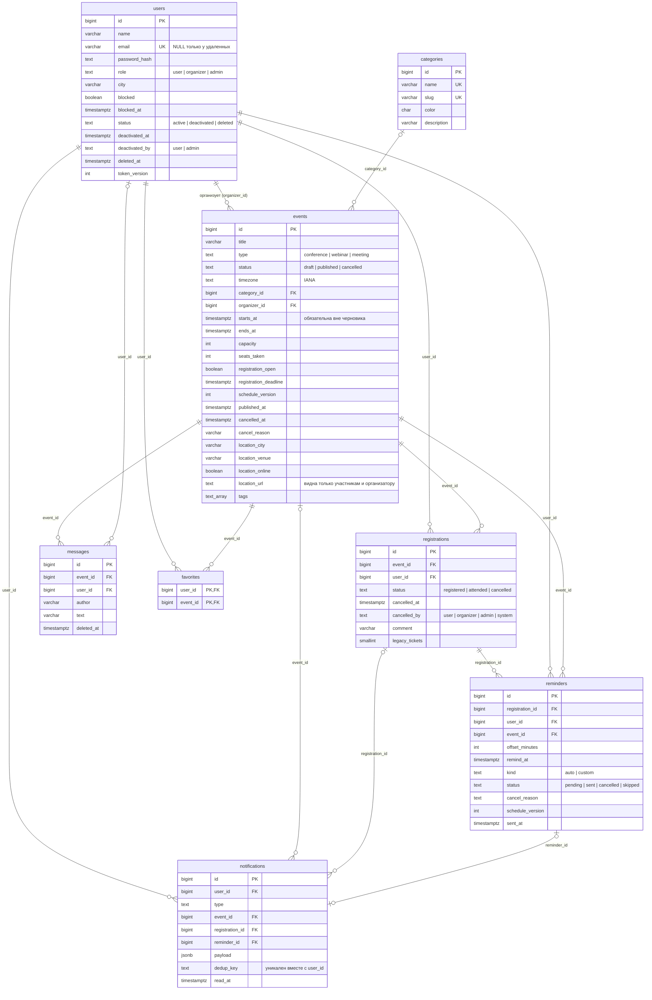

# Модель данных EventHub

Схема после миграций этапов А и Б (`migrations/`). Диаграмма в формате Mermaid отображается на GitHub и в редакторах с поддержкой Mermaid.

## Ограничения и индексы, важные для логики

| Таблица | Правило | Как обеспечено |
|---|---|---|
| registrations | Не больше одной активной регистрации пользователя на мероприятие | частичный уникальный индекс `(event_id, user_id) WHERE status <> 'cancelled'` |
| registrations | Отмена всегда с отметкой времени | `CHECK ((status = 'cancelled') = (cancelled_at IS NOT NULL))` |
| events | `0 ≤ seats_taken ≤ capacity` | CHECK; счетчик меняется атомарным UPDATE в транзакции регистрации |
| events | Опубликованное и отмененное мероприятие имеет дату начала; срок регистрации не позже начала; окончание позже начала | CHECK |
| reminders | Ожидающее напоминание привязано к регистрации; одно напоминание на смещение | CHECK `reminders_pending_has_registration`, частичный уникальный индекс `(registration_id, offset_minutes)` |
| notifications | Одно уведомление на событие для пользователя | UNIQUE `(user_id, dedup_key)`; ключи: `reminder:<id>:v<версия>`, `event:<id>:rescheduled:v<версия>`, `event:<id>:location:<время>`, `event:<id>:cancelled`, `registration:<id>:cancelled` |
| users | email обязателен, кроме удаленных; состояние согласовано с отметками времени | CHECK `users_email_unless_deleted`, `users_deleted_at_check`, `users_deactivated_check` |

Пользователь при удалении не удаляется из таблицы, а обезличивается, поэтому внешние ключи с `ON DELETE CASCADE` на `users` историю не стирают.
